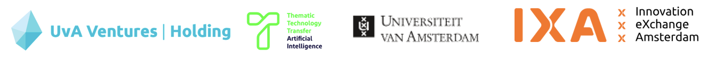

*Thinking of starting a deeptech AI startup?*

This mini workshop is for UvA students and researchers wanting to know more about how to bring your scientific research towards a startup. We will tell more about the academic startup journey and provide practical information but also will give attendees enough time to interact with the speakers among an academic entrepreneur who went through all this.

{% include alert info='
* Date: Wednesday 28 October 2026
* Time: 14:00 - 17:00 hr
* Location: <a href="https://www.google.com/maps/place/SustainaLab/@52.3555818,4.9519582,17z/data=!3m1!4b1!4m6!3m5!1s0x47c6090030f2ae55:0xaa34c155ca3ded9f!8m2!3d52.3555786!4d4.9545385!16s%2Fg%2F11nvxmwl7t!5m1!1e2?hl=en&entry=ttu&g_ep=EgoyMDI2MDkyMC4wIKXMDSoASAFQAw%3D%3D">Sustainalab, Matrix I</a>, Science Park Amsterdam' %}

### Program:
	
  

| Time           |    Activity / Speaker    |
|--------- |---------|
|  14:00   |  Welcome by Bernd Ensing   |
|  14:05   |  Introduction of the Workshop |
|          |  *Peter Westerhuijs - Program Manager TTT-AI* | 
|  14:10   |  Science to Impact         |
|          |  *Marcel Bartels - Impact Developer IXA* |
|  14:25   |  The AI Startup Journey    |
|          |  *Ross Gordon - Investment Manager, Amsterdam Venture Studios* |
|  14:55   |  How to spinout from the University |
|          |  *Annemieke de Raad - Business Developer IXA* |
|  15:15   |  break  |
|  15:30   |  Entrepreneurship, real world experience |
|          |  *Harro Stokman - CEO/Founder Kepler Vision Technologies* |
|  16:00   |  Interactive session with the attendees |
|  16:30   |  Drinks & Bites and more interaction    |

### Registration
<a class="radius button small" href="https://forms.gle/WiVfhXu8diidGebm6">Register here</a>

Organisers:
* [Peter Westerhuijs][6]
* [Drs. M.J. (Marcel) Bartels][7]

