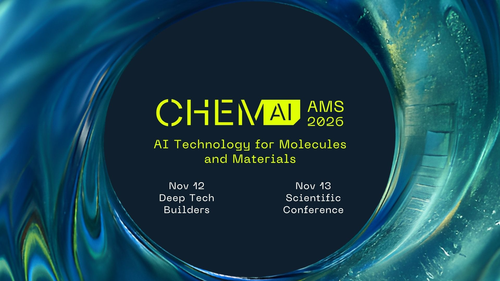

On November 12–13, ChemAI returns to Amsterdam for its 2026 edition, bringing together researchers, industry, startups, and investors working at the intersection of AI, robotics, quantum and chemistry, materials science, and pharma.



The **program** features keynotes from world-leading researchers and innovators, including:
* Prof. Max Welling – CTO & founder of CuspAI
* Dr. Heike Riel – IBM Head of Quantum & AI, President of the German Physical Society
* Prof. Timothy Noël – University of Amsterdam
* Dr. Erik Bekkers - University of Amsterdam
* Prof. Steven Latré – VP of AI at IMEC
* Prof. Tonio Buonassisi – VP of Sustainable Energy at CSEM
* Dr. Yang Cao – Staff Scientist at Acceleration Consortium, University of Toronto
* … and many more, including University of Toronto, NYU, TUM, Siemens, NVIDIA, TOPSOE, VSParticle, Quantinuum, etc.
 

The **poster session** offers researchers an opportunity to present their work, with cash prizes awarded to the top three posters thanks to Matterstack.ai.
The **company exhibition** connects researchers, startups, and industry.

* ChemAI Website: [https://www.acnetwork.nl/chemai][1]
* Program: [https://www.canva.com/design/DAHNYv4GNIg/D9jRaLM-Y6_6pP7SHfoDuQ/view][4]
* Day 1 registrations: [https://luma.com/aihouse-eyno][2]
* Day 2 registrations: [https://www.eventbrite.nl/e/chemai-2026-day-2-conference-nov-13-tickets-1994828364337][3] (recommended for academics)

We warmly encourage you to share this invitation with colleagues, PhD students, research groups, and industry connections who may be interested in the rapidly developing field of AI for molecules and materials.

[1]: https://www.acnetwork.nl/chemai
[2]: https://luma.com/aihouse-eyno
[3]: https://www.eventbrite.nl/e/chemai-2026-day-2-conference-nov-13-tickets-1994828364337
[4]: https://www.canva.com/design/DAHNYv4GNIg/D9jRaLM-Y6_6pP7SHfoDuQ/view

